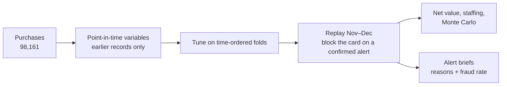

<h1 align="center">Stopping the card</h1>

<p align="center"><b>Card-fraud scoring judged by the fraud it stops</b><br>
The model finds the run. A confirmed alert blocks the card. Speed decides the value.</p>

<p align="center">
  <a href="https://github.com/J-A-Y-0/card-fraud-scoring/actions/workflows/ci.yml"></a>
  
  
  
</p>


<p align="center"><sub>The planner compares response speeds on two months the model never saw. The alert queue shows why each alert fired; the analyst makes the call.</sub></p>

<p align="center"><a href="https://j-a-y-0.github.io/card-fraud-scoring/"><b>Planner</b></a> · <a href="https://j-a-y-0.github.io/card-fraud-scoring/alerts.html"><b>Alert queue</b></a> · <a href="reports/fraud-scoring-report.pdf"><b>Report (PDF)</b></a> · <a href="reports/fraud-scoring-deck.pdf"><b>Deck (PDF)</b></a></p>

## The business case

**The problem.** A purchase-card program loses money to compromised cards. Analysts can check only a few alerts a day, and the usual model test overstates how much fraud a score catches.

**What I found**, on Nov–Dec 2010, months the model never saw:

- **The usual test is wrong.** A random train/test split reported {rand_test} detection. On later months, the same model caught {rand_oot}.
- **The value is in the card.** {first_day} of fraud dollars land on a card's first fraud day. A confirmed alert is worth the rest of the run it stops.
- **Speed beats coverage.** With the same alerts, blocking the card the same day stops more fraud for less work.

| Out-of-time, Nov–Dec 2010 | Block next day | Block same day |
| --- | --- | --- |
| Fraud dollars stopped | {next_share} | **{same_share}** |
| Net value, two months | {net} | **{same_net}** |
| Analyst time | {next_minutes} min a day | **{same_minutes} min a day** |

**Recommendation.** Review the top 3% of scores ({oot_fdr} of fraud found), block cards the same day, and run a 60-day shadow pilot before going live.

## Who does what

| Job | Who |
| --- | --- |
| Rank every purchase by fraud risk | **Model** |
| Explain each alert: reasons and measured fraud rate | **Code** |
| Call the cardholder, confirm or clear | **Analyst** |
| Block and reissue the card | **Card operations** |
| Set the review budget and response speed | **Program owner**, with the planner |

## How it works



| Validation | Response speed |
| --- | --- |
|  |  |
| A random split overstates detection by {rand_gap} points; a time-ordered split lands within {temp_gap}. | Blocking sooner stops more of each run. |

## Quick start

Runs in about two minutes on synthetic data. No dataset or API key needed.

```sh
git clone https://github.com/J-A-Y-0/card-fraud-scoring.git
cd card-fraud-scoring
uv sync
uv run fraudscore synth
FRAUD_DATA_DIR=data/synthetic FRAUD_ARTIFACTS_DIR=artifacts/synthetic uv run fraudscore all --quick
uv run pytest
```

To browse the tools locally: `python -m http.server -d site`, then open <http://localhost:8000>.

## Project structure

| | |
| --- | --- |
| `src/fraudscore/` | cleaning, variables, splits, tuning, card-block replay, economics, alert briefs |
| `site/` | planner, alert queue, report and deck (static HTML) |
| `reports/` | report and deck PDFs |
| `tests/` | unit tests, offline |

## Limitations

- **Small sample.** {fraud_cards_oot} compromised cards in the test window: the direction of each finding is solid, its size is uncertain.
- **Assumptions.** Labels are taken as complete, and a blocked card is assumed to stop the fraudster. Costs are planning values you can change in the planner.
- **Data.** The transaction file is not redistributed. `site/data/` holds only aggregates and a relabeled, rounded alert sample.
